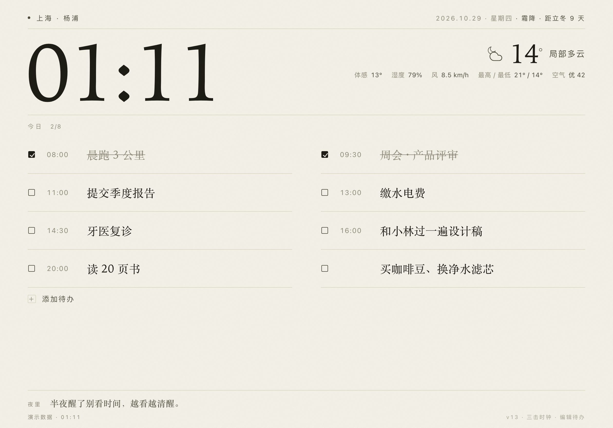
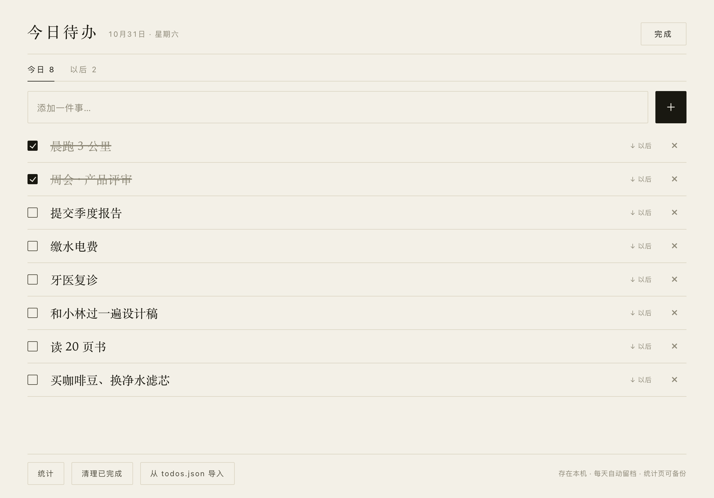
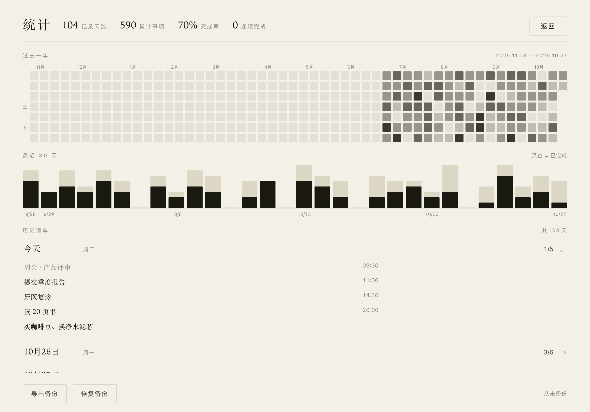

# 墨水屏提示板 · iPad Pro 11"

把闲置 iPad 变成一块常亮的桌面提示板，横屏摆在桌上或墙上。版面是单列自上而下：**顶部**地点与日期（含节气与“距下一节气还有几天”），**右上**今日天气，**中间**是**两列**的今日待办，**底部**健康提示与状态行——待办是主角。

整个方案就是一个 HTML 文件：天气走免费接口，**待办全部存在这台 iPad 本地**。没有后端、没有账号、没有订阅。



---

## 目录

- [为什么是"网页"而不是 App](#为什么是网页而不是-app)
- [三分钟跑起来](#三分钟跑起来)
- [部署到能长期访问的地址](#部署到能长期访问的地址)
- [iPad 端设置（关键，逐条照着做）](#ipad-端设置关键逐条照着做)
- [改成你家的数据和清单](#改成你家的数据和清单)
- [室内温湿度怎么来](#室内温湿度怎么来)
- [护屏、烧屏与电池](#护屏烧屏与电池)
- [其它路线对比](#其它路线对比)
- [常见问题](#常见问题)

---

## 为什么是"网页"而不是 App

iPad 上没有真正的"墨水屏待机板"App，能同时满足「常亮 + 全屏 + 自定义内容 + 不花钱」的，只有一条路：

> 自己写一个网页 → 用 Safari 打开 → 加到主屏幕 → 用「引导式访问」锁死 → 设置「自动锁定：永不」。

好处是改一个数字就能改整块板，坏处是要有个地址让 iPad 打开（不是必须公网，见下文三种部署方式）。

> ⚠️ 先明确一点：**iPad 没有温湿度传感器**。天气里的温湿度来自气象接口（室外），想要"室内温湿度"必须外接传感器，见[这一节](#室内温湿度怎么来)。

---

## 三分钟跑起来

```bash
cd ipad-eink-board
python3 -m http.server 8000
```

浏览器打开 `http://localhost:8000` 就能看到效果（`?demo=1` 是不联网的演示数据，`?night=off|dim|invert` 可以强制切换日间/夜间样式）。

想先在电脑上确认版面：直接双击 `index.html` 也行，但建议用上面的本地服务器，避免浏览器对本地文件的限制。

---

## 部署到能长期访问的地址

按省事程度排序，选一个：

### A. GitHub Pages（免费、最稳、推荐）

1. 新建一个仓库，把 `index.html`、`todos.json` 传上去（网页上直接拖拽即可）。
2. 仓库 Settings → Pages → Source 选 `main` 分支 / `root` → Save。
3. 一分钟后得到 `https://<用户名>.github.io/<仓库名>/`，iPad 打开这个地址。
4. 以后想改待办：在 GitHub 网页上直接编辑 `todos.json`，提交，板子 30 分钟内自己刷新。

### B. Cloudflare Pages / Vercel

把文件夹拖进 Cloudflare Pages 控制台即可，自带 HTTPS 和 CDN。适合已经有账号的人，速度在国内通常比 GitHub Pages 好。

### C. 只在家里用（不上公网）

跑在一台常开的 Mac / NAS / 树莓派上：

```bash
python3 -m http.server 8000        # 临时
# 或者用 nginx / caddy 指向这个目录
```

iPad 访问 `http://192.168.1.x:8000`。

> 注意：**局域网 http 地址无法使用"屏幕常亮"接口**（浏览器要求 https 或 localhost）。这时只能靠「设置 → 显示与亮度 → 自动锁定 → 永不」来保持亮屏，也能用。想要 Wake Lock 就用 A / B 的 https 地址。

---

## iPad 端设置（关键，逐条照着做）

| # | 设置 | 路径 | 说明 |
|---|---|---|---|
| 1 | 横屏 | 控制中心关闭「竖排方向锁定」 | 页面本身是响应式的，但横屏才是设计版式 |
| 2 | 永不息屏 | 设置 → 显示与亮度 → 自动锁定 → **永不** | 同时**关掉低电量模式**，否则会强制 30 秒锁屏 |
| 3 | 加到主屏 | Safari 打开网页 → 分享 → 「添加到主屏幕」 | 从主屏图标启动就是无地址栏的全屏窗口 |
| 4 | 锁死应用 | 设置 → 辅助功能 → 引导式访问 → 打开并设密码 | 打开网页后连按三下侧边键启动；**不要**关闭"触摸"，否则没法勾待办 |
| 5 | 灰度（可选） | 设置 → 辅助功能 → 显示与文字大小 → 色彩滤镜 → 灰度 | 想要"真墨水屏"观感就开；页面本身已经几乎没有彩色 |
| 6 | 更柔和（可选） | 设置 → 辅助功能 → 显示与文字大小 → 降低白点值 → 40% | 夜间特别有用 |
| 7 | 免打扰 | 设置 → 专注模式 → 勿扰 常开 | 避免弹窗盖住板子 |
| 8 | 关自动更新 | 设置 → 通用 → 软件更新 → 自动更新 → 全关 | 否则凌晨可能自动重启，板子挂在锁屏界面 |
| 9 | 亮度自动化 | 「快捷指令」App → 自动化 | 23:00 设定亮度 0%，07:00 设定亮度 35%，配合页面的夜间样式 |

关于第 9 条，新建两个「个人自动化 → 特定时间」，动作选「设定亮度」，不要勾"运行前询问"。这是让 iPad 夜里真正"熄灯"的唯一办法——网页本身没法关掉屏幕。

---

## 改成你家的数据和清单

全部配置都在 `index.html` 顶部的 `CONFIG` 里，改完刷新即可。

### 1. 位置（必改）

```js
location: { name: "上海 · 徐汇", lat: 31.1884, lon: 121.4336, tz: "Asia/Shanghai" },
```

经纬度在[高德坐标拾取](https://lbs.amap.com/tools/picker)或 Google Maps 上右键就能拿到。`name` 只是显示文字。

### 2. 天气与空气质量

用的是 [Open-Meteo](https://open-meteo.com/)：**免费、免注册、无 Key、支持 CORS**，直接 `fetch` 就能取。只取**今天**，只占页面右上角一小块：温度、状况、体感、湿度、风、最高/最低、US AQI（温度与状况是主信息，其余压成一行小字）。

### 3. 今日待办（存在 iPad 本地）

板子上点「**＋ 添加待办**」，或者点「今日」那一行，打开待办面板：



- **加**：上面输入内容，需要的话先点左边的时间框选个时间，按键盘上的「完成」或右边的 ＋。加完输入框自动清空并保持聚焦，可以连着加几条。
- **勾**：点方框。板上也能直接勾，不用进面板。
- **改**：面板里直接点那行字就能改；要改时间就点时间。
- **删**：点行尾的 ×。
- **排序**：有时间的按时间先后排在前面，没时间的排后面。板上分两列显示，**左右交替**（1、2 / 3、4 / 5、6……），最多 12 条，多出来的在「添加待办」右边标「还有 N 项」。

数据写在**这台 iPad 的 Safari 本地存储**（`localStorage`）里，断网、锁屏、关掉再打开都还在，不经过任何服务器。

**跨天规则**：每天 0 点，系统会把**当天的完整清单**（包括没做完的）写进历史，然后把没做完的顺延到新的一天。历史**不设上限**——一天大约 300 字节，十年也就 1MB 级；只有本地存储快撑爆时才会自动丢掉最老的一半。不想要留档就把 `CONFIG.todos.dailyArchive` 改成 `false`。

**`todos.json` 还需要吗？** 需要，但只当备份和初始化用：第一次打开时用它播种；在面板底部点「从 todos.json 导入」可以手动覆盖（换 iPad、恢复备份时用）。

> ⚠️ 本地存储的边界：清空 Safari 网站数据、删掉主屏幕图标重装、换设备，清单都会没有。重要的内容建议在 `todos.json` 里也留一份，或者告诉我加一个「导出到文件」。

### 4. 统计与备份

待办面板底部点「统计」进入统计页：



- **顶部**：记录天数、累计事项、完成率、连续完成（当天全部做完才算，今天还没做完不算断）。
- **过去一年**：一天一格，颜色越深 = 当天完成的越多。
- **最近 30 天**：柱子深色是已完成、浅色是没做完；没记录的日子只剩一条基线。
- **历史清单**：按天倒序排，点一行展开当天完整清单（含没做完的）。

**备份**：统计页底部有「导出备份 / 恢复备份」。iPad 上导出会走系统分享面板，可以直接存进「文件」或 iCloud Drive；要在新设备上恢复，选那个 JSON 即可，会覆盖当前清单和全部历史。旁边一行会显示「上次备份：X 天前」，超过一个月没备份就去点一下。

### 5. 节气

顶部日期行会带出**当前节气**和**距下一个节气还有几天**，例如 `2026.10.29 · 星期四 · 霜降 · 距立冬 9 天`；节气当天显示成「今日霜降」。

它不联网、不查表，是页面里用 Meeus 太阳视黄经公式现算的（找黄经到达 15° 整数倍的时刻，再换算成北京时间），24 个节气都在里面，未来年份也能算，误差在十几分钟以内——只有恰好在午夜前后几分钟交节时才可能差一天。

### 6. 健康提示

底部那行字跟着**此刻几点**变，上面再压一层天气：

| 优先级 | 什么时候 | 标签 | 配置 |
|---|---|---|---|
| 1 | 当天天气命中条件（下雨、空气差、极冷极热…） | 今日提醒 | `tips.conditional` |
| 2 | 其余时候，按当前时段 | 早上 / 白天 / 晚上 / 夜里 | `tips.timeSlots` |

时段划分（`from` 含、`to` 不含，跨零点就写 `from > to`）：

| 标签 | 范围 | 举例 |
|---|---|---|
| 早上 | 05:00–09:00 | 起床先喝一杯温水，比咖啡更早叫醒身体。 |
| 白天 | 09:00–17:00 | 每坐 45 分钟起身走两分钟。 |
| 晚上 | 17:00–22:00 | 晚饭吃七分饱，夜里睡得更沉。 |
| 夜里 | 22:00–05:00 | 该睡了，明天的事留给明天。 |

每个时段有 8 条专属文案，另外还有一个 **`tips.general` 通用池**（10 条，任何钟点看都成立，比如「每天走 6000 步」），会混进四个时段的轮换里——所以任意时刻的候选是「8 条时段 + 10 条通用」共 18 条。

页面每分钟比对一次，**跨时段自动换**；同一时段内一天换一条，18 天轮完一圈。

顶部的节气（见上一节）只是背景信息，不参与提醒的选择。

### 7. 外观

```js
display: {
  nightMode: "dim",   // dim 暗纸 / invert 反色 / off 不切换
  nightStart: 22,
  nightEnd: 7,
  pixelShift: true    // 每 4 分钟整体偏移 1px，缓解 OLED 烧屏
}
```

---

## 室内温湿度怎么来

iPad 不会告诉你房间里的温湿度，必须给它一个数据源。`CONFIG.indoor` 打开后指向任意返回 JSON 的地址即可：

```js
indoor: {
  enabled: true,
  label: "客厅",
  url: "http://192.168.1.50:8080/env",  // 返回 {"temperature": 24.1, "humidity": 55}
  tempPath: "temperature",
  humPath: "humidity"
}
```

三种常见做法：

| 方案 | 成本 | 说明 |
|---|---|---|
| **HomePod mini / HomePod（第二代）** | 已有就不用花钱 | 自带温湿度传感器，但数据在 HomeKit 里。需要 **Home Assistant** 的 HomeKit Controller 接入，再用模板传感器拼成上面那个 JSON |
| **米家 / Aqara / SwitchBot 温湿度计 + 网关** | 60–150 元 | 大多数支持本地局域网协议（SwitchBot 有开放 API、Aqara 有 HomeKit 模式），同样经 Home Assistant 转发最省事 |
| **ESP32 + SHT31** | 40 元左右 | 最自由。几十行 Arduino 代码跑个 HTTP 服务返回 `{"temperature":24.1,"humidity":55}`，插在板子旁边，精度比天气接口实在得多 |

> 已经有 Home Assistant 的话，整个方案可以更简单：直接用 HA 自带的仪表盘 + WallPanel/kiosk 浏览器，天气、温湿度、日历、待办全在里面。见下一节。

---

## 护屏、烧屏与电池

**11 英寸 iPad Pro 有两代屏幕，处理方式不同：**

- **2018 / 2020 / 2021 / 2022 款（LCD）**：不会烧屏，随便用，只需要注意背光老化。
- **2024 款 M4（串联 OLED）**：长时间静态显示高对比内容有残影风险。建议：
  - 白天亮度不超过 60%，夜间 5–10%；
  - 用 `nightMode: "dim"`（暗纸）而不是纯黑底白字；
  - 保留 `pixelShift`（已内置，每 4 分钟整体挪 1px）；
  - 别让大面积纯白常驻——这块板子的纸色是 `#f3f0e7`，已经是刻意压低对比度的。

**电池**：一直插着电、屏幕常亮、机身温热，是电池老化最快的组合。能做的：

1. 用**小功率充电头**（5W/12W 足够），别用 30W 快充，发热小很多；
2. 避免阳光直射和闷在密闭空间，支架要能散热；
3. 设置 → 电池 → 充电优化保持开启（部分 iPadOS 版本有「80% 上限」）；
4. 接受它作为"长期插电设备"的定位——两年后电池健康度掉到 80% 出头是正常的，反正它不再需要移动使用。

**摆放**：11 寸横屏约 25 × 18 cm，买一个**磁吸支架**（iPad Pro 背面有磁铁）或木质画框改一下，把充电线从背后走。放在玄关、书桌侧前方、厨房台面都合适——这恰好是"扫一眼"的距离，1–2 米。

---

## 其它路线对比

| 方案 | 成本 | 优点 | 缺点 |
|---|---|---|---|
| **本方案：自建网页** | 0 元 | 完全可控，改一行字就改版式；无账号无订阅 | 需要自己部署一个地址；室内传感器要另配 |
| **Home Assistant 仪表盘** | 门槛高 | 温湿度、日历、待办、摄像头全能接；有现成卡片 | 要一台常开的主机，配置学习曲线陡 |
| **DAKboard / MangoDisplay** | $5–10/月 | 开箱即用，日历/照片/天气都有 | 订阅制；数据在云端；版式不可细调 |
| **MagicMirror²** | 0 元 + 树莓派 | 模块生态最丰富，可做真正的镜子 | 需要一台常开机器；模块质量参差；中文字体要自己调 |

如果你已经有 Home Assistant，其实直接用 HA 更划算；如果只是想要一块"安静的信息板"，本方案改动成本最低。

---

## 常见问题

**Q：为什么天气偶尔显示"离线缓存"？**
A：接口超时或断网时，页面会用上一次的温度并标出时间，网恢复后自动更新。日志在页脚左侧。

**Q：待办和数据存在哪？会不会丢？**
A：全部存在 iPad 本机的 `localStorage` 里，不上传。会丢的只有三种情况：清空 Safari 网站数据、删掉主屏幕图标重装、换设备。所以统计页做了「导出备份」，建议一个月点一次，存进 iCloud Drive。

**Q：能不能自动同步 Apple 提醒事项 / 日历？**
A：能，但要加一层：用「快捷指令」的「获取提醒事项」+「获取 URL 内容」把结果 POST 到自己的服务端（或 GitHub Gist），页面读那个 JSON。属于进阶玩法，不在本文件范围内。

**Q：iPad 会自动回到 Safari 首页吗？**
A：从主屏幕图标启动 + 引导式访问锁定时不会。如果你发现它退出了，通常是系统自动更新重启，关掉自动更新即可。

**Q：字体和电脑上不一样？**
A：页面用的是系统衬线字体栈（iPad 上是 New York + 宋体/Songti SC），这是刻意的——衬线数字配细线分隔，才有纸质告示牌的味道。

---

## 文件说明

```
ipad-eink-board/
├── index.html       ← 全部内容（HTML + CSS + JS，单文件，无依赖）
├── todos.json       ← 初始清单 / 备份，可远程编辑
├── preview-day.png  ← 日间效果
├── preview-dim.png  ← 夜间「暗纸」
├── preview-dark.png ← 夜间「反色」
├── preview-rain.png  ← 雨天提醒
├── preview-stats.png ← 统计页
└── preview-sheet.png ← 待办面板
```
